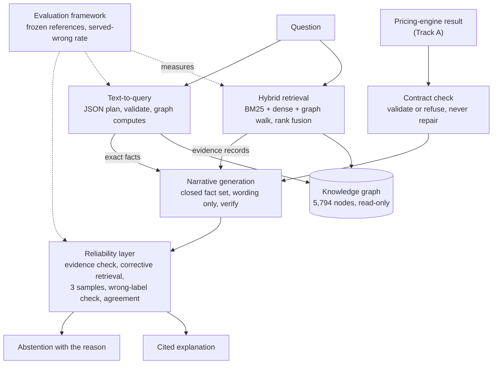
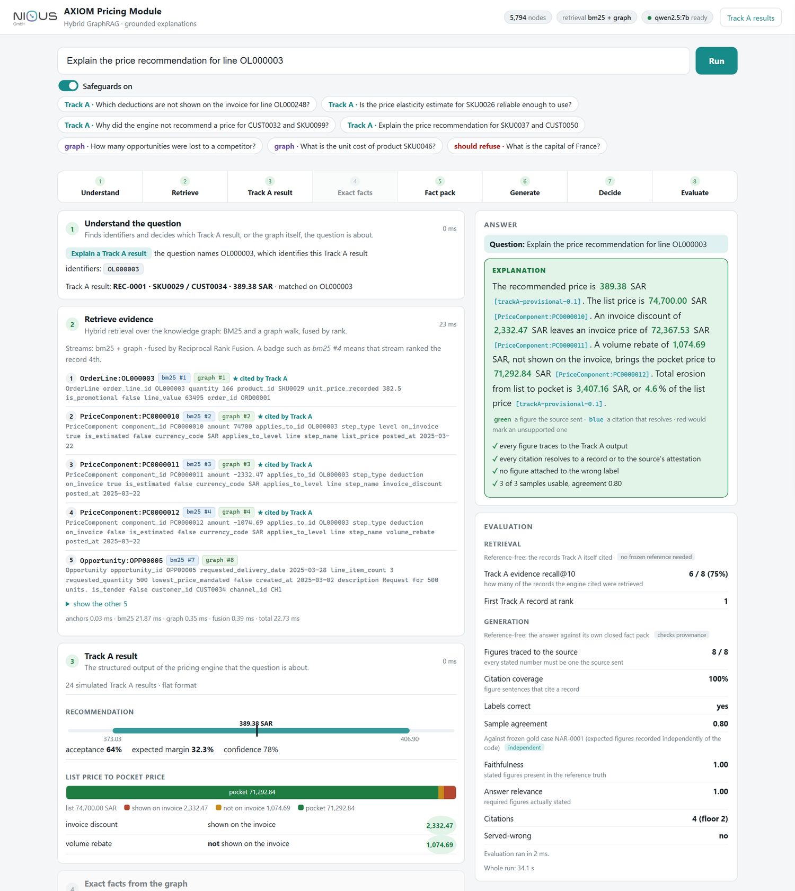
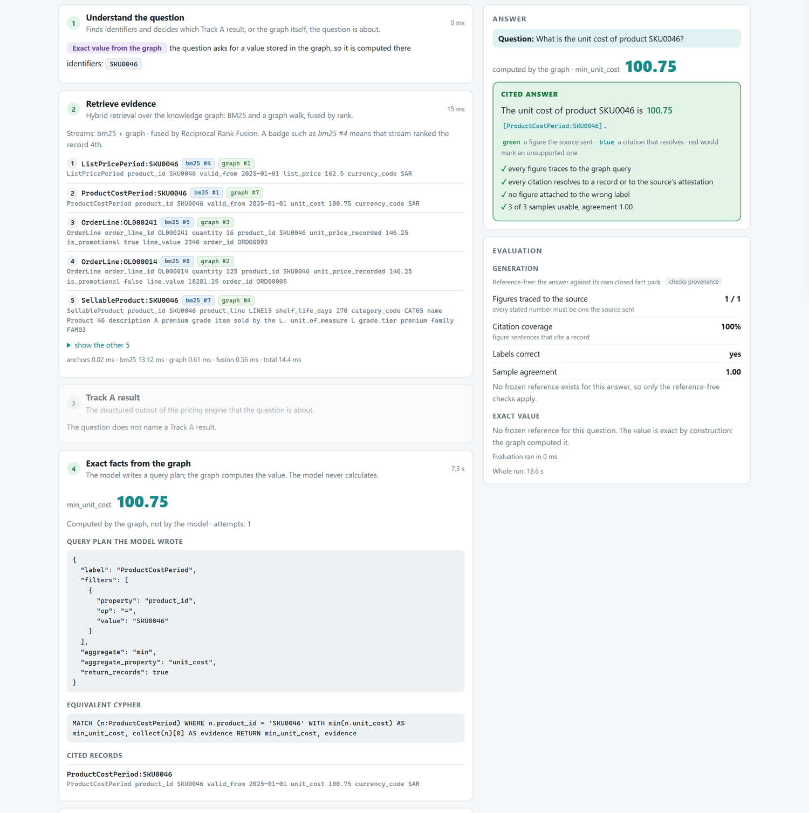

# AXIOM Pricing Module · Track B

### Hybrid GraphRAG and grounded narrative generation


-brightgreen)
-informational)


Track B is the explanation layer of the **AXIOM Pricing Module**, built during an internship at
NIOUS GmbH. A pricing engine (Track A) computes price waterfalls and price recommendations. Track B
makes those figures **explainable**: it finds the supporting evidence in an enterprise knowledge
graph, answers exact questions by letting the graph do the arithmetic, and writes short explanations
in which **every figure comes from the engine and every statement cites the record it rests on**. When
the evidence, or the system's own output, cannot be trusted, it **abstains and says why**.

> **Explain, do not compute; ground, do not guess.**
> The layer never invents or recalculates a number. The engine's structured output is the single
> source of truth.

| | |
|---|---|
| **Author** | Mohamed Dhya Shiri, ESPRIT (Tunisia), internship at NIOUS GmbH, 1 July to 31 August 2026 |
| **Stack** | Python 3.13 · BM25 · sentence-transformers · Neo4j (optional) · Ollama · FastAPI |
| **Status** | Deliverables D1 to D6 delivered (English) and D7 (integration) demonstrated end to end; connecting the live pricing engine is the next step |
| **Data** | Synthetic. Not included in this repository, see [Data availability](#data-availability) |

---

## Contents

1. [What it does](#what-it-does)
2. [Results at a glance](#results-at-a-glance)
3. [Architecture](#architecture)
4. [Components](#components)
5. [The reliability layer](#the-reliability-layer)
6. [Interactive demo](#interactive-demo)
7. [Quick start](#quick-start)
8. [Configuration](#configuration)
9. [Evaluation](#evaluation)
10. [Project layout](#project-layout)
11. [Testing](#testing)
12. [Design principles](#design-principles)
13. [Limitations and next steps](#limitations-and-next-steps)
14. [Data availability](#data-availability)

---

## What it does

A commercial team that has to defend a price needs more than the number. It needs to know which
deductions applied and which records support them. A language model writes fluent explanations, and
fluency is the risk: it may state a figure nobody computed, attach a correct figure to the wrong
label, or cite a record that does not say what the sentence claims.

Track B addresses three connected problems:

| Problem | What Track B does |
|---|---|
| **Finding evidence** | Hybrid retrieval over a 5,794-node knowledge graph: lexical (BM25), semantic (dense) and graph-traversal search, fused by rank |
| **Exact facts** | Counts, maxima and sums come from the graph, never from a model's arithmetic. A model writes a validated, read-only *query plan*; the graph computes the value |
| **Trustworthy explanation** | The model only words a **closed set of figures** taken from the engine's result. Every figure is verified, every sentence that states one must cite a record, and three independent samples must agree, otherwise the system withholds the answer with its reason |

A worked example (one order line, `OL000003`):

```text
The recommended price for SKU0029 is 389.38 SAR [trackA-provisional-0.1], with a range from
373.03 SAR to 406.90 SAR [trackA-provisional-0.1]. The list price is 74,700.00 SAR
[PriceComponent:PC0000010], reduced by an invoice discount of 2,332.47 SAR [PriceComponent:PC0000011],
leading to an invoice price of 72,367.53 SAR. Further deductions, specifically a volume rebate of
1,074.69 SAR [PriceComponent:PC0000012], not shown on the invoice, bring the pocket price down to
71,292.84 SAR. Total erosion from the list price to the pocket price is 3,407.16 SAR, or 4.6 % of the
list price [trackA-provisional-0.1].
```

Every number traces to the engine's result, and every citation is a record handle (`Label:identifier`)
that resolves to a real record in the graph.

---

## Results at a glance

Measured with the local `qwen2.5:7b` model on the 5,794-node export. Retrieval metrics are at k = 10.
The reference sets are small (18 to 24 cases) and were labelled by one person, so the results
demonstrate the mechanisms and their relative merits, not a field-level error rate.

| Measure | Result |
|---|---|
| Hybrid retrieval against the best single retriever | **MRR 0.764 vs 0.725** (23 graded questions); **0.831 vs 0.797** (18 exact-record questions) |
| Answering record found in the top 10 | **18 of 18** exact-record questions |
| Cross-encoder reranking (optional) | Top-1 rate 56.5 % → 78.3 %, recall@10 0.906 → 0.674 (a trade-off, off by default) |
| Exact queries (text-to-query, no database) | **19 of 20 correct (95.0 %)**, mean 1.15 attempts; the one miss is genuinely ambiguous in the data |
| Explanations (reliability layer, 4 runs × 24 results) | **0 served with false content among 94 served**; faithfulness **1.000**; citation coverage **1.000** |
| Wrong-label check | all **24** correct narratives accepted; all **144** injected value swaps caught |
| Served-wrong target | ≤ 5 %; observed bound ≈ 3 % (rule of three over 94 served; indicative, not a proof) |
| Automated tests | **487**, of which **462** run offline in about 35 s |

<details>
<summary><b>Retrieval results by configuration</b></summary>

| Configuration | MRR | Top-1 | R@10 | Found (18) | MRR (18) |
|---|---:|---:|---:|---:|---:|
| BM25 only | 0.725 | 0.522 | 0.841 | 18/18 | 0.797 |
| Dense only | 0.221 | 0.174 | 0.210 | 7/18 | 0.270 |
| Graph only | 0.467 | 0.304 | 0.855 | 17/18 | 0.478 |
| BM25 + graph | 0.710 | 0.478 | 0.942 | 18/18 | 0.733 |
| BM25 + dense | 0.519 | 0.435 | 0.587 | 14/18 | 0.566 |
| **Hybrid (default)** | **0.764** | 0.565 | 0.906 | 18/18 | **0.831** |
| Hybrid + cross-encoder | 0.839 | 0.783 | 0.674 | 18/18 | 0.794 |

The streams are complementary: dense retrieval alone is weak on near-identical key–value records, the
graph stream finds neighbourhoods rather than answers, and pairs of streams fall below BM25 alone. The
gain comes from combining all three. Margins are modest (about one question's rank).

</details>

<details>
<summary><b>Explanation runs on the 24 simulated pricing results</b></summary>

| Run | Configuration | Served | False content | Relevance | Agreement |
|---|---|:---:|:---:|:---:|:---:|
| R1 | reliability layer (k = 3) | 24/24 | 0 | 1.000 | 0.907 |
| R2 | reliability layer (k = 3) | 23/24 | 0 | 1.000 | 0.855 |
| R3 | reliability layer (k = 3) | 23/24 | 0 | 1.000 | 0.831 |
| R4 | reliability layer (k = 3) | 24/24 | 0 | 0.990 | 0.866 |
| B1 | baseline (1 sample) | 23/24 | 0 | 1.000 | n/a |
| B2 | baseline (1 sample) | 24/24 | 0 | 1.000 | n/a |
| B3 | baseline (1 sample) | 24/24 | 0 | 0.990 | n/a |

Neither configuration produced a wrong answer in these runs, so the value of the wrong-label check is
shown by a controlled test: given one narrative that passes verification but is misattributed (the list
price correct, the invoice price carrying the pocket price's value), the baseline serves it every time
and the reliability layer withholds it. The reliability layer costs about three times the baseline's
inference time.

</details>

---

## Architecture



The two query components share **one graph** and **one citation scheme**, so a sentence can be followed
back to the exact record. The narrative generator reads figures only from the validated engine result
and from values the graph computed.

### Hybrid retrieval

```
                        question
                           │
                   AnchorResolver          grounds identifier mentions in the graph
                           │
        ┌──────────────────┼──────────────────┐
      BM25              Dense              Graph
   (lexical)          (semantic)        (traversal, 2 hops, decay 0.5)
        └──────────────────┼──────────────────┘
                 ReciprocalRankFuser         rank-based, weighted, k-smoothed
                           │
                CrossEncoderReranker         optional, calibrated, thresholded
                           │
                 ranked evidence + per-result trace
```

| Modality | Catches | Would miss alone |
|---|---|---|
| **BM25** | Exact identifiers: `SKU0001`, `CUST0015`, `162.5` | Paraphrase ("price reduction" vs `invoice_discount`) |
| **Dense** | Meaning without shared vocabulary | Blurs `SKU0001` and `SKU0002` together |
| **Graph** | Structurally related records sharing *no* words with the query | Anything not connected to a named entity |

The three score on incompatible scales (unbounded BM25, cosine, hop-decay). **Reciprocal Rank Fusion**
discards magnitude and uses rank only, so it needs no per-retriever calibration:

```
score(d) = Σ  weight(stream) / (k + rank_in_stream(d))        default k = 60
```

---

## Components

| Component | What it does | Code |
|---|---|---|
| **Graph layer** | One in-memory `KnowledgeGraph` built from a JSON export or a read-only Neo4j projection. Citation handles (`OrderLine:OL000248`) are *derived from the data*, not hard-coded | `src/graph/` |
| **Hybrid retrieval** | BM25, dense and graph streams, anchors, rank fusion, optional cross-encoder, full per-result trace | `src/retrieval/`, `src/pipeline/` |
| **Text-to-query** | The model emits a JSON query plan; the plan is validated (schema, value guard, write-incapable), executed in memory or compiled to Cypher, with a bounded self-healing retry loop | `src/text_to_query/` |
| **Contract parser** | Validates the pricing engine's result object at the boundary; refuses anything that does not reconcile and never repairs it. Also reads the engine's draft 0.2.0 format (experimental) | `src/narrative/contract.py`, `engine_draft.py` |
| **Narrative generation** | Builds a closed fact set, prompts a local model for wording only, then verifies numbers and per-sentence citations. Question mode answers a specific question from the same closed set | `src/narrative/` |
| **Reliability layer** | Evidence assessment, corrective retrieval, k-sample self-consistency, wrong-label check, quorum, agreement, abstention | `src/reliability/` |
| **Evaluation framework** | Frozen references read from disk, never through the code under test; retrieval, query and narrative harnesses; served-wrong rate | `src/evaluation/` |
| **Web demo** | A workbench that runs one question through every stage live | `demo_app/` |

### Text-to-query in one example

```text
Question: What is the maximum discount agent AG011 can approve?

Plan:    {"label": "AuthorityPeriod",
          "filters": [{"property": "agent_id", "op": "=", "value": "AG011"}],
          "aggregate": "max", "aggregate_property": "max_discount_pct"}

Cypher:  MATCH (n:AuthorityPeriod) WHERE n.agent_id = 'AG011'
         RETURN max(n.max_discount_pct) AS max_max_discount_pct
```

The plan cannot express a write. A filter that is provably empty (a value the graph never holds) is
refused rather than returned as zero.

---

## The reliability layer

Each gate can only **withhold** an answer, never rewrite it, and each was validated against the failure
it targets.

| Step | Mechanism | Catches |
|---|---|---|
| 1. Evidence assessment | Support ratio (records per figure) against a floor of 0.75 | Thin evidence |
| 2. Corrective retrieval | Re-fetches only on-subject records; adds records, never figures | Missing context |
| 3. Sampling | k = 3 samples at temperature 0.7 | Single-sample luck |
| 4. Verification | Every figure must be in the closed set; every figure-stating sentence must cite an existing record | Invented numbers, bad citations |
| 5. Wrong-label check | Does a figure sit under the noun the engine assigned it? | A *true* number attached to the *wrong* label, which the verifier cannot see |
| 6. Quorum | At least 2 of 3 samples must pass steps 4 and 5 | Unstable output |
| 7. Agreement | Samples must agree (0.6 minimum): *core over union* for overviews, *overlap* for question answers | Divergent samples |

An explanation is either served with its citations or withheld with a stated reason. Relevance and
advice gates also decline a question before any model call when it is unrelated to the result or asks
for a recommendation (the system explains the engine's figures and does not advise).

---

## Interactive demo

A browser workbench: type a question and watch it travel through the architecture, each stage showing
the real output of the component behind it, finishing with a live evaluation scored by the project's own
metrics. Nothing on the page is stored or static, and it never writes to the graph.

| # | Stage | Shows |
|---|---|---|
| 1 | Understand | Identifiers found, route chosen (explain a Track A result, exact value, or needs a result) |
| 2 | Retrieve | Ranked evidence with the stream and rank that found each record |
| 3 | Track A result | Recommendation, price waterfall, flags |
| 4 | Exact facts | The query plan the model wrote, the Cypher, the value the graph computed |
| 5 | Fact pack | The closed set of figures the answer may use |
| 6 | Generate and verify | Each sample with its verification and wrong-label marks |
| 7 | Reliability | Evidence check, quorum, agreement, serve or withhold |
| 8 | Evaluate | Faithfulness, citation coverage, agreement, against frozen references where they exist |





Run it with `./run_demo.ps1`; see [README_DEMO.md](README_DEMO.md) for questions to try and for
using it as a test bench for the pricing engine's own output.

---

## Quick start

**Prerequisites:** Python 3.13+, and [Ollama](https://ollama.com) with `ollama pull qwen2.5:7b` for
anything that generates text. Retrieval and the test suite need no model and no database.

```bash
python -m venv .venv
.venv\Scripts\activate                 # Windows  (source .venv/bin/activate on Linux/macOS)
pip install -r requirements.txt
```

Place the data files described in [Data availability](#data-availability) first, then:

```bash
# Retrieval (offline: lexical + graph, no model download, ~15 ms)
python demo_retrieval.py --offline
python main.py --offline "What is the list price of product SKU0001?"

# Exact question: the graph computes the number, not the model
python ask_graph.py "How many opportunities were lost to a competitor?"

# Explain a pricing result with per-sentence citations
python explain_price.py --facts
python explain_end_to_end.py --offline             # retrieval -> text-to-query -> narrative

# One result through the full reliability layer (--list shows the 24)
python scripts/explain_with_reliability.py --id REC-0005

# Measure quality against the frozen reference sets
python evaluate_retrieval.py --cases
python evaluate_text_to_cypher.py --cases           # needs the local model
python evaluate_narratives.py --offline
python run_questions.py --offline --isolate        # hybrid vs each single retriever

# Web demo
./run_demo.ps1                                     # add -Dense for semantic retrieval

# Tests (hermetic: no network, no database, ~35 s)
pytest
```

Configuration is optional: the defaults run as they are. Copy `.env.example` to `.env` only to change
something.

### Using a live Neo4j database (optional)

```bash
# in .env
CORPUS_SOURCE=neo4j
NEO4J_URI=bolt://localhost:7687
NEO4J_USER=neo4j
NEO4J_PASSWORD=your-password
```

```bash
python demo_retrieval.py --source neo4j
RUN_LIVE_GRAPH_TESTS=1 pytest          # includes source-parity integration tests
```

Both sources produce the same `KnowledgeGraph`, so behaviour is identical either way, and a test
asserts that write statements are refused server-side.

---

## Configuration

Every tunable is declared once in `src/config/settings.py`, bound from the environment, and validated at
start-up (for example `RRF_K must be >= 1, got 0`). The full reference is in `.env.example`.

| Variable | Default | Effect |
|---|---|---|
| `CORPUS_SOURCE` | `json` | `json` or `neo4j` |
| `DEFAULT_TOP_K` | `10` | Final result count |
| `RRF_K` | `60` | Higher favours cross-modal agreement |
| `FUSION_STREAM_WEIGHTS` | `{"bm25": 1.0, "graph": 1.0, "dense": 0.3}` | Per-stream weight (the measured configuration) |
| `GRAPH_MAX_HOPS` / `GRAPH_HOP_DECAY` | `2` / `0.5` | Traversal radius and decay per hop |
| `RERANK_ENABLED` | `false` | Cross-encoder reranking (off in the measured configuration) |
| `RERANK_TOP_N` | `20` | Cross-encoder depth (bounds latency) |
| `LLM_MODEL_NAME` | `qwen2.5:7b` | Local model served by Ollama |
| `NARRATIVE_MIN_CITATION_COVERAGE` | `1.0` | Share of figure-stating sentences that must cite a record |
| `RELIABILITY_SAMPLES` | `3` | k in self-consistency |
| `RELIABILITY_MIN_AGREEMENT` | `0.6` | Agreement floor before abstaining |
| `RELIABILITY_MIN_SUPPORT_RATIO` | `0.75` | Records-per-figure floor that triggers corrective retrieval |

---

## Evaluation

Retrieval and generation are evaluated **separately**, because a faithful explanation built on a
retriever that missed the key record is still wrong. Generation is scored against fixed reference
answers rather than a language-model judge.

| Stage | Metrics | Reference |
|---|---|---|
| Retrieval | MRR, top-1, recall@k, nDCG@k | 23 graded questions, 18 exact-record questions, 44-question bank |
| Exact queries | Correct value, attempts | 20 questions whose expected values are computed directly from the export |
| Explanations | Faithfulness, answer relevance, citation coverage, **served-wrong rate** | 24 frozen cases whose expected figures are read from disk, with a drift guard that refuses to write a report if the references and the data disagree |

The **served-wrong rate** is defined over *served* explanations, so that abstaining is rewarded rather
than hidden. Every flagged narrative is recorded verbatim so the rate can be audited by reading the text.

---

## Project layout

```text
project_trackB/
├── main.py                  # ask a retrieval question
├── demo_retrieval.py        # staged retrieval walkthrough
├── ask_graph.py             # exact questions (text-to-query)
├── explain_price.py         # one cited explanation
├── explain_end_to_end.py    # retrieval -> text-to-query -> narrative
├── evaluate_retrieval.py · evaluate_text_to_cypher.py · evaluate_narratives.py · run_questions.py
├── run_demo.ps1             # start the web demo
├── demo_app/                # FastAPI service and single-page workbench
├── scripts/                 # reliability CLI, import tools, sample generators, share-zip builder
├── src/
│   ├── config/              # typed environment readers, one frozen settings object
│   ├── graph/               # KnowledgeGraph, JSON and Neo4j sources, schema introspection
│   ├── retrieval/           # BM25, dense, graph, anchors, fusion, reranker, corpus
│   ├── pipeline/            # retrieval orchestration and composition root
│   ├── text_to_query/       # plan, schema pruning, validation, self-healing engine
│   ├── narrative/           # contract, fact set, generator, verifier, engine reader, relevance gate
│   ├── reliability/         # attribution, consistency, corrective retrieval, narrator
│   └── evaluation/          # metrics and the retrieval / query / narrative harnesses
├── tests/                   # 487 tests (462 offline, 25 live)
└── data/                    # NOT published: see data/README.md
```

---

## Testing

```bash
pytest                    # 487 tests (462 offline, 25 live skipped by default), ~35 s
pytest -k fusion          # one area
pytest -v                 # per-test names
```

The language model, the encoders and the graph source are injected, so tests substitute deterministic
fakes and run without a network. Notable suites: the **144-swap sweep** of the wrong-label check,
Arabic-aware tokenisation, source parity between JSON and Neo4j, the contract parser's boundary
rejections, the verifier against fabricated figures, and a regression test for the D4-versus-D5 gate.

---

## Design principles

* **No hard-coded schema.** No label, relationship or property name is wired into the code. A record's
  citation handle is derived by scoring each property name against the node's own label, so a label the
  graph has never contained resolves without a code change.
* **One retriever interface.** Every modality takes a `RetrievalQuery` and returns ranked results;
  adding a fourth means appending one object.
* **Configuration over code, and dependency injection.** Thresholds, weights and model names live in
  one validated settings object; the model, encoders and graph source are injected.
* **Auditability.** Every result carries the rank it held in each stream, its hop distance and
  traversal path, and its pre-rerank position.
* **Graceful degradation.** A failing modality contributes an empty stream; a reranker outage falls
  back to fused order and records that it did so.
* **Safeguards that fail safe.** Each gate can only withhold; none can invent or rewrite.
* **Local and read-only.** All inference runs locally, and the graph is never written to.

---

## Limitations and next steps

**Known limitations**

* The reference sets are small (18 to 24 cases) and single-labelled, and the explanation experiments use
  **illustrative** recommendation figures (waterfall levels and record identifiers are real; recommended
  price, range, confidence, margin and probability are simulated), so results demonstrate mechanisms,
  not a field-level error rate.
* The wrong-label check relies on linguistic rules that approximate whether a sentence asserts a value.
* Statements are checked for numbers and citations only; there is no automatic score of whether an
  on-topic answer is *relevant* to the question, and the relevance and advice gates are lexical.
* Text-to-query matches one record type at a time (no joins). A single local 7B model was used.
* Arabic: right-to-left handling and bilingual labels exist and are unit-tested, but Arabic generation
  is out of scope for this phase (the corpus contains no Arabic text, and Arabic retrieval scored lower).
* The reader for the engine's draft 0.2.0 format is **experimental** and was tested only on a
  hand-built sample.

**Next steps**

1. Connect the live output of the pricing engine and repeat the measurements on it.
2. Replace the rule-based wrong-label check with claim-level verification (entailment).
3. Calibrate the agreement threshold on a held-out set for a target error rate.
4. Render records as natural-language sentences and add a multilingual encoder (Arabic).
5. Larger, independently labelled reference sets, and query plans that join across relationships.

---

## Data availability

The `data/` folder, the knowledge-graph export `axiom_pricing_module_Knowledge-graph_PoC.json` and the
written reports are **intentionally not published** (see `.gitignore`). The graph holds synthetic
records (5,794 nodes, 7,765 relationships, 24 node labels, 17 relationship types). `data/README.md`
lists the files a local checkout expects. Without them the code, the configuration and the offline test
fixtures are readable, but the evaluation commands and the demo need the data files; request them from
the project owner.

---

## Acknowledgements

Developed at **NIOUS GmbH** (Ostfildern, Germany) as part of
an internship for ESPRIT, École Supérieure Privée d'Ingénierie et de Technologies (Tunisia).
